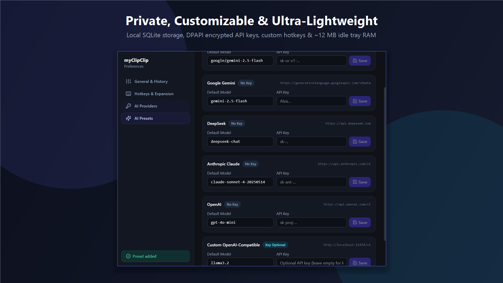

# myClipClip

**An Alfred-inspired Windows clipboard manager, smart snippet expander, and multi-provider AI search assistant — built natively with .NET 8, Edge WebView2, and React.**

-0078D6?style=flat-square&logo=windows)

---

## Why myClipClip?

Stop losing time to repetitive typing, buried clipboard history, and constant browser tab-switching.

Knowledge workers, developers, and support teams copy and paste dozens of times an hour—losing focus every time they hunt for a lost snippet, retype boilerplate responses, or switch windows to ask an AI assistant a quick question.

myClipClip brings clipboard history, smart text expansion, and multi-provider AI into one instant keyboard-driven command palette—without slowing down your PC or compromising data privacy.

**myClipClip** pairs a native **C# (.NET 8) Win32 host** with Windows' built-in **Edge WebView2 Runtime** and a **60-second idle auto-unload watchdog** — giving you a crisp Alfred-style UI and streaming Markdown AI window at a fraction of the footprint:

| Metric | myClipClip v1.0 |
| :--- | :--- |
| **App Folder Size** | **3.97 MB** (`myClipClip.exe` is **3.20 MB**) |
| **Windows Setup Installer (NSIS)** | **1.26 MB** |
| **Idle Memory in System Tray** | **~12.6 MB Working Set / ~11.2 MB Private** (1 process) |
| **Idle Clipboard CPU Usage** | **0%** (event-driven Win32 `WM_CLIPBOARDUPDATE`) |
| **Data & Privacy** | **100% Local SQLite** + **Windows DPAPI** encrypted API keys |

---

## Screenshots

| Clipboard History (`Shift+Win+C`) | Smart Snippets & Placeholders (`Shift+Win+X`) |
| :---: | :---: |
|  |  |

| Separate AI Search Markdown Window | Settings & AI Providers |
| :---: | :---: |
|  |  |

---

## Features

### Clipboard History (`Shift+Ctrl+C`)
- **Multi-format capture**: Plain text, screenshots/images (stored cleanly on disk with previews & dimensions), and copied file paths (`CF_HDROP`).
- **Configurable retention**: Defaults to **10 days** (choose `1d`, `7d`, `10d`, `30d`, `90d`, `Forever`, or custom). Automatic background pruning.
- **Smart organization**: SHA-256 deduplication, pinning (exempt from retention cleanup), instant multi-token search, and source app tagging.
- **Instant auto-paste**: Press `Enter` to restore focus to your previous Windows app and paste automatically via Win32 `SendInput`.

### Smart Snippets & Global Auto-Expansion (`Shift+Ctrl+X`)
- **Collections & tags**: Organize reusable templates or promote any clipboard history item to a snippet in one click.
- **Dynamic placeholders**: Resolved automatically when pasted or expanded:
  - `{date}` (`YYYY-MM-DD`), `{time}` (`HH:mm`), `{time_full}` (`HH:mm:ss`), `{datetime}`, `{isodate}`, `{day}`, `{year}`, `{month}`, `{clipboard}`.
- **Global auto-expansion**: Assign optional trigger keywords (e.g., `!standup`, `!sig`) — typing them in any Windows app replaces them in place (toggleable anytime from the system tray).
- **Backup**: One-click JSON **Import** (merge/replace) and **Export**.

### AI Search — Separate Markdown Result Window (`Tab` or `Shift+Ctrl+A`)
- **Analyze copied text or images**: Send any clipboard item (`Tab`) or your current clipboard (`Shift+Win+A`) to an independent, resizable Markdown AI window.
- **6 Built-in AI Providers (BYOK)** — switch provider and model on the fly:
  | Provider | Protocol | Example Models |
  | :--- | :--- | :--- |
  | **OpenRouter** | OpenAI-compatible SSE | `google/gemini-2.5-flash`, `anthropic/claude-sonnet-4`, `deepseek/deepseek-chat-v3-0324`, `openai/gpt-4o-mini` |
  | **Google Gemini** | Native Gemini SSE | `gemini-2.5-flash`, `gemini-2.5-pro`, `gemini-2.0-flash` |
  | **DeepSeek** | OpenAI-compatible SSE | `deepseek-chat`, `deepseek-reasoner` |
  | **Anthropic Claude** | Native Messages SSE | `claude-sonnet-4-20250514`, `claude-3-5-haiku-latest` |
  | **OpenAI** | OpenAI-compatible SSE | `gpt-4o-mini`, `gpt-4o`, `o3-mini` |
  | **Custom OpenAI-Compatible** | OpenAI-compatible SSE | Any local or remote model (Ollama, LM Studio, Groq, Together, etc.) |
- **Quick Presets & Multi-Turn Chat**: Built-in customizable presets (*Explain*, *Summarize*, *Fix Grammar*, *Translate*, *Code Review*, *Key Takeaways*) plus follow-up questions in the same thread.
- **Rich GFM Markdown**: Live streaming with **Stop** button, tables, syntax-highlighted code blocks with per-block **Copy**, plus **Copy MD**, **Copy Plain**, and **Save as Snippet**.

### Privacy & Security
- **Local-first**: All history and snippets live locally in `%APPDATA%\myClipClip\clipclip.db` (SQLite WAL mode). Zero analytics or telemetry.
- **Encrypted API keys**: All AI keys are encrypted at rest with **Windows DPAPI** (`ProtectedData`).
- See [PRIVACY.md](https://hex2023.github.io/myClipClip/privacy.html) for the full privacy policy.

---

## Keyboard Shortcuts

| Shortcut | Action |
| :--- | :--- |
| `Ctrl+Shift+C` | Toggle Clipboard History *(configurable in Settings)* |
| `Ctrl+Shift+S` | Toggle Snippets View *(configurable in Settings)* |
| `Ctrl+Shift+A` | Open AI Search on current clipboard *(configurable in Settings)* |
| `Enter` | Auto-paste selected item/snippet into previous app |
| `Shift+Enter` | Copy selected item/snippet without auto-pasting |
| `Tab` | Send selected history item to AI Search |
| `Ctrl+P` | Pin / unpin selected history item |
| `Alt+1` – `Alt+9` | Quick-paste top 9 history items |
| `Ctrl+1` / `Ctrl+2` | Switch between History and Snippets tabs |
| `Ctrl+,` | Open Settings |
| `Esc` | Dismiss launcher |

---

